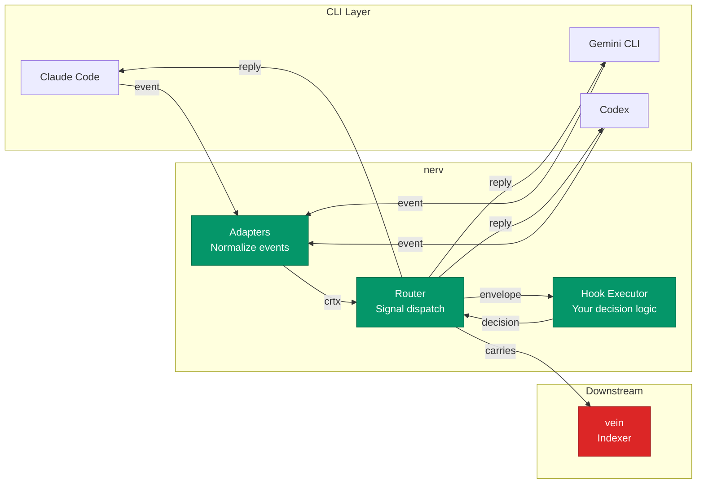

# nerv — Universal Hooks Protocol

[](https://github.com/hop-top/poly-nerv/actions/workflows/ci.yml)
[](https://pkg.go.dev/hop.top/nerv)
[](LICENSE)

Write one hook. Run it on every AI coding CLI.

## The problem

You build a guardrail — say, block `rm -rf /` before it executes.
You wire it into Claude Code. It works. Then your team adopts
Gemini CLI. And someone else uses Codex. Now you maintain three
copies of the same hook, each with different config formats,
different event names, different blocking semantics.

nerv fixes this. One hook definition, one event taxonomy, one
handler contract. nerv adapters translate per-CLI differences so
your hook code never changes.

## Who this is for

- **Vibe coders** who want guardrails, audit logs, or workflow
  automation across whichever AI CLI they happen to use today
- **Devtool authors** who ship hooks/plugins and don't want to
  maintain N integrations for N CLIs

## How it works

```
CLI event → Adapter → nerv envelope → Your hook (stdin JSON)
                                         ↓
                                   Decision (stdout JSON)
                                         ↓
                              nerv merges → Reply to CLI
```

Your hook is an executable. It reads a JSON envelope from stdin,
decides what to do, writes a JSON decision to stdout, and exits.

## In the crtx ecosystem

nerv is the signal router for the [`crtx`](https://github.com/hop-top/spec-crtx) envelope format — carrying turns between agents and adapting CLI events to a unified taxonomy. Downstream, [vein](https://github.com/hop-top/poly-vein)
indexes the envelopes nerv carries:



**Exit codes are the contract:**

| Code | Action  | What happens                         |
|------|---------|--------------------------------------|
| 0    | allow   | Event proceeds                       |
| 1    | warn    | Event proceeds; user sees a message  |
| 2    | block   | Event rejected; user sees why        |
| 3    | rewrite | Event proceeds with modified payload |
| >=4  | error   | Fail-open: logged, event proceeds    |

## Install

Pick the layer you want. The CLI/daemon are Go binaries; the
five SDKs are client libraries that talk to `nervd` over a Unix
socket.

| Layer       | Install                                                              |
|-------------|----------------------------------------------------------------------|
| CLI/daemon  | `go install hop.top/nerv/cmd/nerv@latest` (and `cmd/nervd`) — available after first tagged release |
| Go SDK      | `go get hop.top/nerv/sdk/go` — available after first tagged release  |
| TS SDK      | `npm i @hop-top/nerv` or `pnpm add @hop-top/nerv`                    |
| Python SDK  | `pip install nerv-sdk`                                               |
| Rust SDK    | `cargo add hop-top-nerv`                                             |
| PHP SDK     | `composer require hop-top/nerv`                                      |
| Shell SDK   | `curl -fsSLO https://raw.githubusercontent.com/hop-top/poly-nerv/main/sdk/sh/nerv.sh`, then `source nerv.sh` |

### Requirements

| Layer      | Minimum                                         |
|------------|-------------------------------------------------|
| CLI/daemon, Go SDK | Go 1.27.3                               |
| TS SDK     | Node.js >= 22.12                                |
| Python SDK | Python >= 3.11                                  |
| Rust SDK   | Rust >= 1.88                                    |
| PHP SDK    | PHP >= 8.2 (wire transport: PECL `grpc`)        |
| Shell SDK  | Bash 4+, `jq`                                   |

## Quick example

Block dangerous shell commands across all CLIs:

```bash
#!/bin/bash
# hooks/block-rm-rf.sh — the envelope arrives on stdin
CMD=$(jq -r '.payload.tool_input.command // empty')
if echo "$CMD" | grep -qE 'rm\s+-rf\s+/'; then
  echo '{"action":"block","message":"rm -rf / blocked by policy"}'
  exit 2
fi
exit 0
```

```yaml
# .nerv/hooks.yaml
version: "1.0-draft"
hooks:
  - name: block-rm-rf
    on: PreToolUse
    match: "Bash|shell|local_shell"
    run: ./hooks/block-rm-rf.sh
```

Then install adapters for whatever CLIs you use and start the
daemon:

```bash
nerv install add      # no CLI name = every detected CLI
nerv daemon start     # spin up nervd in the background
nerv status           # confirm daemon + adapters are green
```

This hook now works on Claude Code, Gemini CLI, Codex CLI, and
OpenCode — no changes needed.

## CLI surface

```
nerv add           Add a hook to the project
nerv capabilities  Emit the machine-readable command surface
nerv create        Generate a hook from a natural-language intent
nerv daemon        Manage the nerv daemon (nervd) — start/stop/status/reload
nerv disable       Disable hooks, events, or hook×event bindings
nerv doctor        Check nerv installation health
nerv enable        Enable hooks, events, or hook×event bindings
nerv inbox         Read the local message inbox
nerv install       Manage adapters: add [cli] (all detected if omitted), status
nerv lint          Lint hooks.yaml for errors and warnings
nerv remove        Remove a hook from the project
nerv replay        Replay a recorded event through the hook pipeline
nerv status        Show nerv daemon and adapter status
nerv tail          Stream live hook events
nerv test          Run hook handlers with synthetic envelopes
nerv upgrade       Show the installed version and the upgrade command
                   (nerv does not update itself)
```

Run `nerv <command> --help` for flags. The daemon (`nervd`) serves
a ConnectRPC `EventService` over a Unix domain socket; SDKs in
all five languages dispatch envelopes through it.

## Slash commands (Claude Code / Codex / Gemini)

See [`.agents/README.md`](.agents/README.md) — seven slash commands
wrap the CLI surface with discovery, multi-select, and an
LLM-driven hook authoring helper:

| Command         | What it does                                      |
|-----------------|---------------------------------------------------|
| `/nerv-add`     | Add a hook (curated marketplace picker)           |
| `/nerv-create`  | LLM-driven hook generator from intent             |
| `/nerv-disable` | Disable hooks / events / hook×event bindings      |
| `/nerv-doctor`  | Installation health check                         |
| `/nerv-install` | Install an adapter for an AI CLI                  |
| `/nerv-replay`  | Replay a recorded event through dispatch          |
| `/nerv-test`    | Run hook handlers with synthetic envelopes        |

Host-agnostic plugin tree lives at `.agents/`; the plugin manifest
is [`.agents/.claude-plugin/plugin.json`](.agents/.claude-plugin/plugin.json).

## 36 canonical events, 8 CLIs

nerv defines 36 canonical events: 26 native (Claude Code's
PreToolUse-class surface) plus 4 extension (gemini/opencode), 2
derived (`MemoryRead`/`MemoryWrite`), and 4 bus (`inbox_message_*`).
Adapters synthesize missing events per CLI. The numerators below use
the 26-native denominator since adapters are scored against the
Claude Code superset; the full taxonomy lives at
[`.agents/references/event-catalog.md`](.agents/references/event-catalog.md).

| CLI         | Native | Synthesized | Total |
|-------------|--------|-------------|-------|
| Claude Code | 26     | 0           | 26/26 |
| Gemini CLI  | 8      | 16          | 24/26 |
| OpenCode    | 10     | 13          | 23/26 |
| Goose       | 11     | 11          | 22/26 |
| OpenHands   | 5      | 15          | 20/26 |
| Codex CLI   | 3      | 12          | 15/26 |
| Vibe        | 6      | 8           | 14/26 |
| Aider       | 0      | 5           | 5/26  |

Events cover the full lifecycle: session, prompt, tool use,
permissions, subagents, tasks, context compaction, file changes,
worktrees, MCP elicitations.

Full event registry: [`spec/events.yaml`](spec/events.yaml). Per-adapter
coverage matrix (which events each adapter delivers natively vs.
synthesizes vs. leaves uncovered): [`docs/capability-matrix.md`](docs/capability-matrix.md).

## Design principles

**Fail-open.** nerv never blocks your workflow due to its own bugs.
Hook crashes, timeouts, bad config — all logged, all allow the
event through. Your guardrails protect you; nerv stays out of
the way when it breaks.

**Redaction by default.** Secrets are stripped from envelopes
before handlers see them. Handlers opt in to full payloads
explicitly.

**One mode.** Handlers are executables. stdin/stdout/exit code.
No SDKs required: handler helpers exist for TypeScript, Python,
and shell; the Go, Rust, and PHP SDKs are daemon clients.
HTTP/gRPC handlers ship as marketplace forwarders, not protocol
modes.

**Adapters do the hard work.** Each CLI gets an adapter that
translates native events to nerv envelopes and nerv decisions back
to CLI-native responses. Synthesis techniques (regex matchers,
background daemons, binary wrappers, MCP proxies) fill gaps
where CLIs lack native events.

## Spec

| Document | What it covers |
|----------|----------------|
| [`spec/events.yaml`](spec/events.yaml) | 36 canonical events (26 native + 4 extension + 2 derived + 4 bus) |
| [`spec/envelope.schema.json`](spec/envelope.schema.json) | Wire format |
| [`spec/hooks.schema.json`](spec/hooks.schema.json) | hooks.yaml config |
| [`spec/handler-contract.md`](spec/handler-contract.md) | Handler protocol |
| [`spec/capabilities.schema.json`](spec/capabilities.schema.json) | Adapter capability maps |
| [`spec/redaction.md`](spec/redaction.md) | Secret redaction |
| [`spec/failure-modes.md`](spec/failure-modes.md) | 12-entry failure matrix |
| [`spec/socket-protocol.md`](spec/socket-protocol.md) | Daemon mode (opt-in) |
| [`spec/testing.md`](spec/testing.md) | Test strategy |

## ctxt integration

nerv itself is a transport: envelopes in, decisions out. The
companion project hop ships a
rule engine that runs on top of nerv and adds a `ctxt:capture`
observer. When a rule fires, the observer pipes a synthesized
text payload from the nerv envelope into
[ctxt](https://github.com/ContextHelp/ContextHelp), giving you a
queryable knowledge graph of every event your guardrails saw —
without changing your hook code or the nerv wire format. nerv
adapters work with this observer the same way they work with
any other rule engine action; capture is opt-in, configured per
rule.

- Captured events: any nerv event the rule engine matches —
  `PreToolUse`, `PostToolUse`, `FileChanged`, `SessionStart`,
  `Elicitation`, and the rest of the 36-event taxonomy. The
  observer ships a minimal field set by default (event type,
  CLI, session, cwd, timestamp, tool name, and tool input for
  Bash) and operators can opt in to additional envelope fields.
- Opting out: rules use the standard `when:` clauses to scope
  capture. Without a `ctxt:capture` observer attached, no event
  reaches ctxt. To narrow further, add matchers (`tool: Bash`,
  `command_matches: ...`) so only the events you want indexed
  fire the observer.
- Failure mode: the observer enforces a 2-second per-call
  timeout and fails open. If ctxt is unreachable, the rule still
  returns its action and downstream observers still fire — nerv's
  fail-open contract is preserved end to end.

## Status

`0.1.0-alpha.0` — first polyglot alpha. Spec complete, CLI/daemon
wired, five SDKs scaffolded,
cross-SDK parity smoke test green.

See [`docs/RELEASING.md`](docs/RELEASING.md) for the release-please
+ publish-on-tag fanout. The six components (the `nerv` CLI module
plus the Go, TS, Python, Rust, and PHP SDKs) are linked-version
(group `nerv`) and share one version. release-please opens a
separate PR per component; merging them cuts one tag each, fanning
out to the Go module proxy, npm, PyPI, crates.io, and Packagist.

## Contributing

Bug reports and feature requests:
[GitHub issues](https://github.com/hop-top/poly-nerv/issues).
Commits follow [Conventional Commits](https://www.conventionalcommits.org/).

## Security

Report vulnerabilities privately; see [SECURITY.md](SECURITY.md).

## License

MIT
